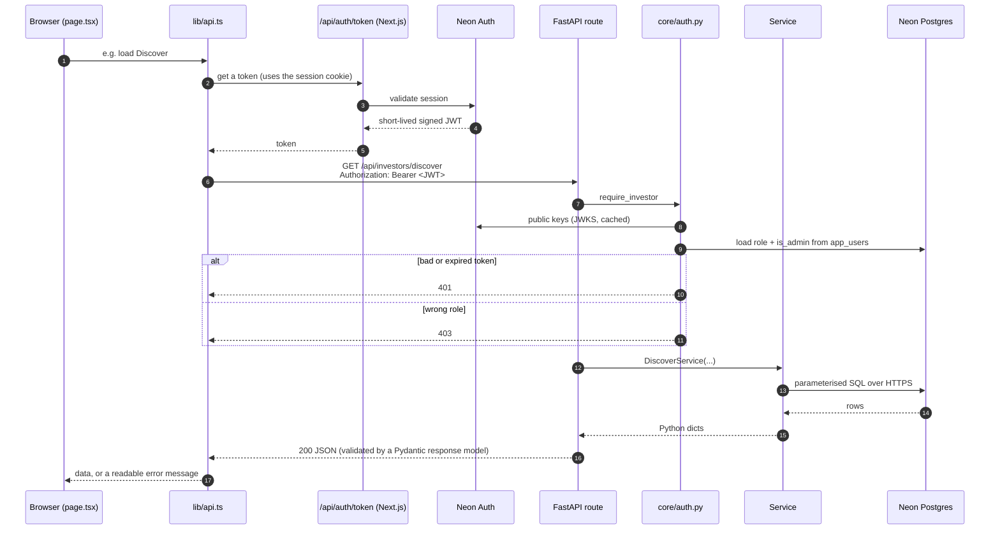
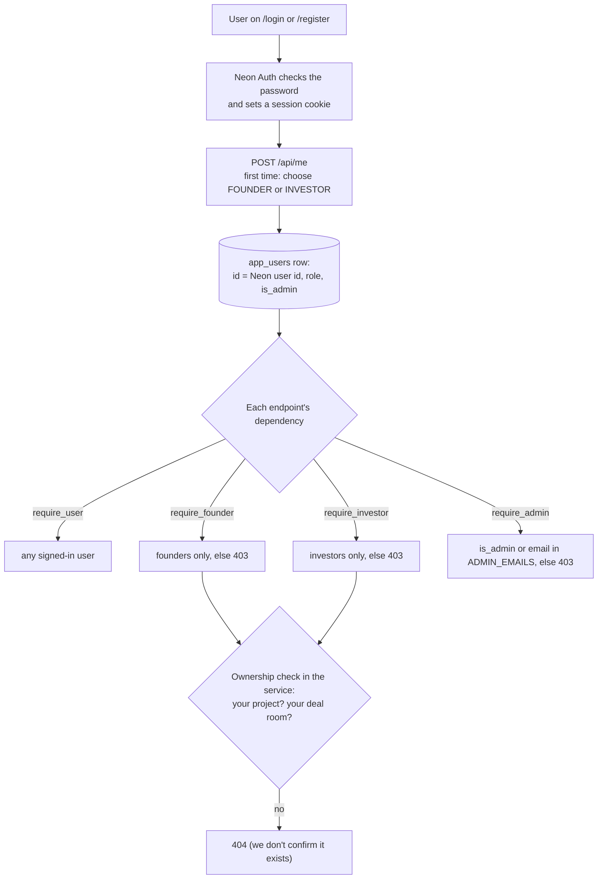

# API communication flow

> How a screen talks to the backend, how sign-in works, and which endpoints the main flow uses. Checked against `frontend/lib/api.ts`, `backend/app/routes/` and `backend/app/core/auth.py` on 27 Nov 2026.

All endpoints live under `/api` (`API_V1_STR` in `backend/app/core/config.py`). Live, clickable documentation is at `http://localhost:8000/docs` while the backend runs.

## 1. One request, start to finish

## 2. Sign-in and roles

The frontend hides screens by role (`PortalLayout.tsx`, `proxy.ts`), but **the backend is the real gate**. Hiding a button is never the only protection.

## 3. Endpoints used by the main flow

| Step | Screen | Method and endpoint | Who may call | Main errors |
|---|---|---|---|---|
| Register role | `/register` | `POST /api/me` | signed in | 422 bad role |
| Create startup | `/founder/projects/new` | `POST /api/projects` | founder | 422 missing fields |
| Publish | project page | `PATCH /api/projects/{id}/publish` | owner | 404 not yours |
| Readiness | project page | `POST /api/projects/{id}/analyze` | owner | 503 AI busy (last report kept) |
| Find investors | `/founder/investors` | `GET /api/founders/investors` | founder | n/a |
| Investor profile | investor card | `GET /api/founders/investors/{investor_id}` | founder | 404 |
| Request intro | investor profile | `POST /api/founders/investors/{investor_id}/intro-requests` | founder | 422 readiness < 50, 409 already requested, 429 daily limit |
| Set criteria | `/investor/preferences` | `GET` / `PUT /api/investors/preferences` | investor | 422 |
| Discover | `/investor/discover` | `GET /api/investors/discover` | investor | n/a |
| See requests | `/investor/deal-flow` | `GET /api/investors/deal-flow` | investor | n/a |
| Interested / Pass | deal flow | `POST /api/interests/{id}/respond` | verified investor (for Interested) | 403 not verified, 409 expired or already replied, 422 pass without a reason |
| Deal room | `/dealroom/{id}` | `GET /api/dealrooms/{id}`, `GET`/`POST /api/dealrooms/{id}/messages` | the two parties | 404 not a party |
| Live chat | deal room | `WebSocket /api/dealrooms/ws/{room_id}?token=...` | the two parties | socket closed |
| NDA | deal room | `POST /api/dealrooms/{id}/nda` | the two parties | n/a |
| Verify investor | `/admin` | `GET /api/admin/verifications`, `POST /api/admin/investors/{user_id}/review` | admin | 403 |

Browsers can't send an `Authorization` header on a WebSocket, so the deal-room page passes the short-lived token in the query string and the server checks it the same way.

## 4. Status codes our API actually returns

| Code | Meaning | Example |
|---|---|---|
| 200 / 201 | OK / created | 201 after an intro request |
| 202 | accepted for later | account deletion request |
| 400 | bad request | answering a request that wasn't a founder's |
| 401 | not signed in / bad token | expired JWT |
| 403 | signed in, not allowed | founder calling an investor endpoint; unverified investor clicking Interested |
| 404 | not found or not yours | someone else's deal room |
| 409 | conflict | already requested; request expired after 14 days |
| 422 | invalid input or a rule not met | readiness under 50; pass without a reason |
| 429 | too many | 5 intro requests a day (10 for a verified company) |
| 503 | dependency down | database or AI unreachable |

## 5. Test it yourself (Thunder Client or Postman)

1. Run the app (`npm run dev:all`) and open `http://localhost:8000/docs`.
2. `GET http://localhost:8000/api/health` needs no token. Expect `"healthy"`.
3. Sign in at `http://localhost:3000`, open the browser console (F12) and run `await fetch('/api/auth/token').then(r => r.json())`. Copy the token.
4. In Thunder Client: `GET http://localhost:8000/api/me` with header `Authorization: Bearer <token>`.
5. Call `GET /api/investors/discover` with an investor token, then with a founder token. Explain why the second returns 403.
6. Tokens are short-lived. On 401 "expired", fetch a new one. Never paste tokens or `.env` values into chats or screenshots.
