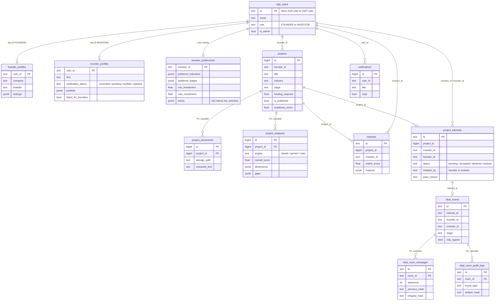

# Database and entity-relationship diagram

> Source of truth: `backend/app/database/schema.sql` (checked 27 Nov 2026). Neon PostgreSQL, 29 tables. The schema is applied automatically every time the API starts (`CREATE TABLE IF NOT EXISTS` plus `ALTER TABLE ... ADD COLUMN IF NOT EXISTS`).

## 1. The core tables of the main flow

This covers the 12 tables the main user flow touches. The other 17 hold portfolio, funding rounds, teams, firms, company updates and verification history. Only the columns that matter for the flow are shown.



## 2. Things to know (and be honest about)

| Point | Detail |
|---|---|
| **Real foreign keys vs links in code** | Child tables of `projects` and `deal_rooms` use real `REFERENCES ... ON DELETE CASCADE` constraints (documents, analyses, messages, audit logs). But `projects.founder_id`, `matches`, `project_interests` and `deal_rooms.project_id` are **links kept by the service code, not database constraints**. Adding constraints there is open item O-10. |
| **Unique pairs** | `matches` and `project_interests` both have `UNIQUE (project_id, investor_id)`. That's why a second intro request for the same pair returns 409. |
| **Copied names** | `project_interests` and `deal_rooms` store copies of names and emails (e.g. `investor_name`). This makes lists fast but means a renamed user can show an old name there. |
| **Money types** | Portfolio and funding tables use `NUMERIC(18,2)` (exact). Older core tables use `DOUBLE PRECISION` for `funding_required`, `min_investment` and `max_investment`. That's fine for ranges and display, but not for ledgers. |
| **JSONB** | Used for lists and flexible settings (criteria, reasons, gaps). Easy to change, harder to query. |
| **Tamper evidence** | Each deal-room message stores the hash of the previous one (`previous_hash` → `integrity_hash`), so editing an old message breaks the chain. |
| **Admins** | `app_users.is_admin`, or a verified email listed in `ADMIN_EMAILS` in `backend/.env`. |

## 3. Practice queries (Stage 2)

```sql
-- Published startups with their founder's email (a JOIN through founder_id)
SELECT p.title, p.readiness_score, u.email
FROM projects p
JOIN app_users u ON u.id = p.founder_id
WHERE p.is_published = true
ORDER BY p.readiness_score DESC;

-- Intro requests by status
SELECT status, COUNT(*) FROM project_interests GROUP BY status;

-- Deal rooms with how many messages each has
SELECT r.id, r.project_title, COUNT(m.id) AS messages
FROM deal_rooms r LEFT JOIN deal_room_messages m ON m.room_id = r.id
GROUP BY r.id, r.project_title;

-- Investors who have not set criteria yet (LEFT JOIN + IS NULL)
SELECT u.email FROM app_users u
LEFT JOIN investor_preferences ip ON ip.investor_id = u.id
WHERE u.role = 'INVESTOR' AND ip.investor_id IS NULL;
```

Run these in the Neon console's SQL editor (read-only queries only). Our code always passes values as parameters (`%s`), never by joining strings, which prevents SQL injection.
