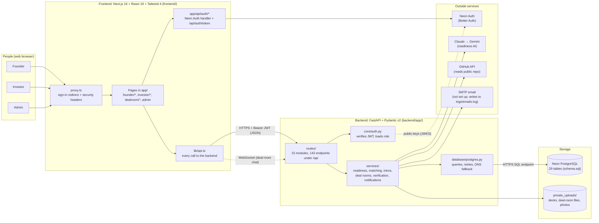
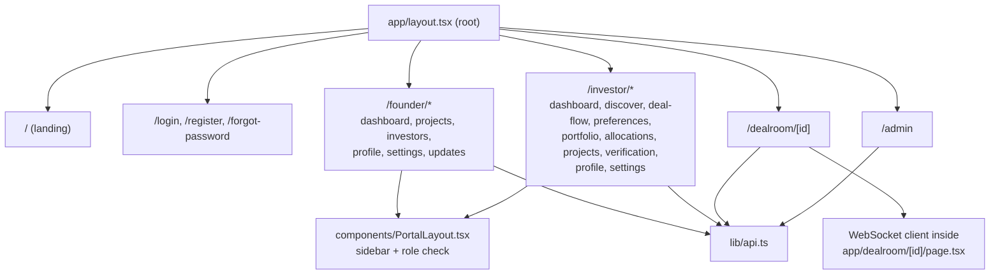
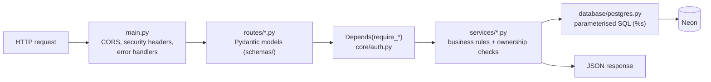
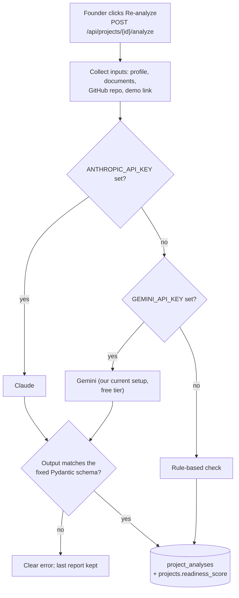

# System architecture

> Shared plan step 4: "Draw one architecture diagram of the product: screens, backend, database and any AI or outside services. Walk through it together."
>
> Everything here was checked against the repository on 27 Nov 2026. The report names the venture "Luma (V-02)". The code in this repo is **VentureX**, so this document describes VentureX. Confirm the venture name with the coordinator (Carry-forward register, item O-01).

The diagrams are written in Mermaid. They render on GitHub and in VS Code (with the Markdown Preview Mermaid Support extension), or you can paste them into https://mermaid.live. A rendered PNG of the overview is in `diagrams/1_architecture.png`.

## 1. The whole system on one page

## 2. What each box is responsible for

| Box | Responsibility | Where it lives |
|---|---|---|
| Founder / Investor / Admin | People using a browser. They never touch the database directly. | n/a |
| `proxy.ts` | Runs before every page. Sends signed-out users to `/login` and sets the Content Security Policy. | `frontend/proxy.ts` |
| Pages | One folder per web address, e.g. `/investor/discover` is `app/investor/discover/page.tsx`. | `frontend/app/` |
| `lib/api.ts` | The single place that calls the backend. Adds the token, turns errors into messages. | `frontend/lib/api.ts` |
| Neon Auth handler | Sign-up, sign-in, sessions. Passwords are checked by Neon Auth, never by our code. `/api/auth/token` gives the browser a short-lived JWT. | `frontend/app/api/auth/` |
| Routes | Receive requests, validate input with Pydantic (bad input returns 422), call a service. | `backend/app/routes/` |
| `core/auth.py` | Verifies the JWT signature with Neon's public keys, loads `role` and `is_admin` from `app_users`, provides `require_founder`, `require_investor`, `require_admin`. | `backend/app/core/auth.py` |
| Services | The business rules. Readiness (`analysis_service.py`), matching (`match_service.py`), intro gate (`founder_outreach_service.py`), deal rooms (`deal_room_service.py`), verification, notifications. | `backend/app/services/` |
| `postgres.py` | Sends SQL to Neon over HTTPS (port 5432 is blocked on our network), retries short connection failures. | `backend/app/database/postgres.py` |
| Neon PostgreSQL | All data: 29 tables. The schema is applied when the API starts. | `backend/app/database/schema.sql` |
| Private disk | Uploaded files. Never served publicly; downloads go through the API with an access check. | `backend/private_uploads/` |
| Claude / Gemini | Readiness reports only. Claude if `ANTHROPIC_API_KEY` is set, else Gemini if `GEMINI_API_KEY` is set, else a rule-based check. Matching never uses AI. | `backend/app/services/ai/` |
| GitHub API | Reads a startup's public repository as extra input to readiness. | `backend/app/services/github_service.py` |
| SMTP | Notification emails. **Not configured yet**: emails are written to `backend/logs/emails.log`. In-app notifications work. | `backend/app/services/email_service.py` |

## 3. Frontend structure

The investor Firm and Company updates pages were removed in Nov 2026; `/investor/firm` and `/investor/updates` redirect to the dashboard (`next.config.ts`).

## 4. Backend layers

Rule of thumb when reading the code: the route says **who** may call it and **what shape** the data has; the service says **what happens**.

## 5. AI integration

When a project is first saved, only the free rule-based check runs (no AI call). The AI path for Claude has not been tested with a real key (Carry-forward register, O-09).

## 6. Implemented vs planned

| Implemented and tested | Planned / not built |
|---|---|
| Sign-up and sign-in (Neon Auth), roles, admin | Real email sending (SMTP) |
| Startup profiles, documents, publish | Public deployment (Render blueprint exists, not live) |
| Readiness report (rules + Gemini) | Payments / pricing |
| Rule-based matching with reasons | NDA as a legal e-signature (today: a recorded click) |
| Intro requests with readiness ≥ 50 gate and daily limit | Live chat across several servers (needs Redis) |
| Deal rooms: chat (WebSocket), NDA click, files, audit log | Automated first check for investor verification |
| Investor verification by an admin | |
| 120 backend tests, 89 API flow checks, 7 browser suites | |

## Walk-through checklist (both founders)

- [ ] Nitya draws section 1 from memory and explains every box to Anshitha.
- [ ] Anshitha explains the same diagram back, without notes.
- [ ] Any box either of us can't explain is circled and studied before the next feature is added.
