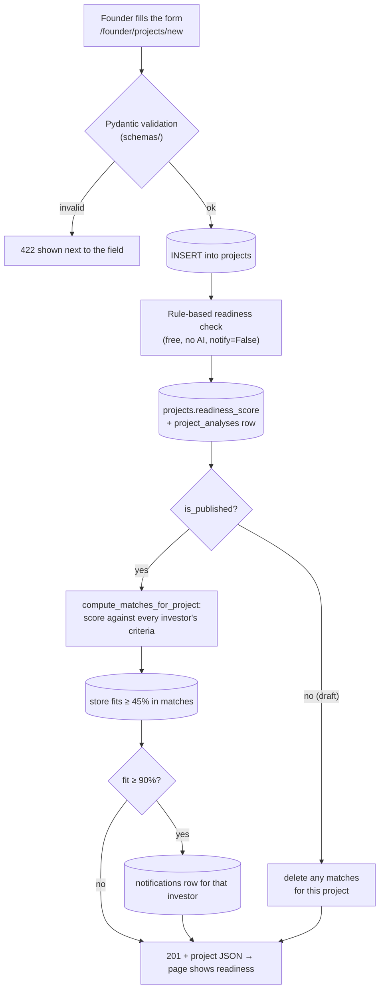
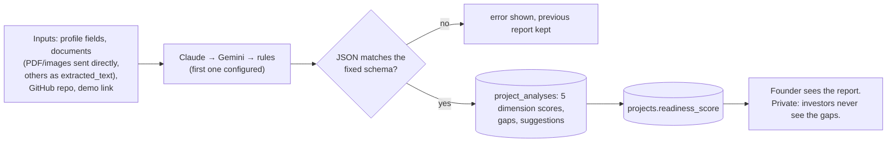
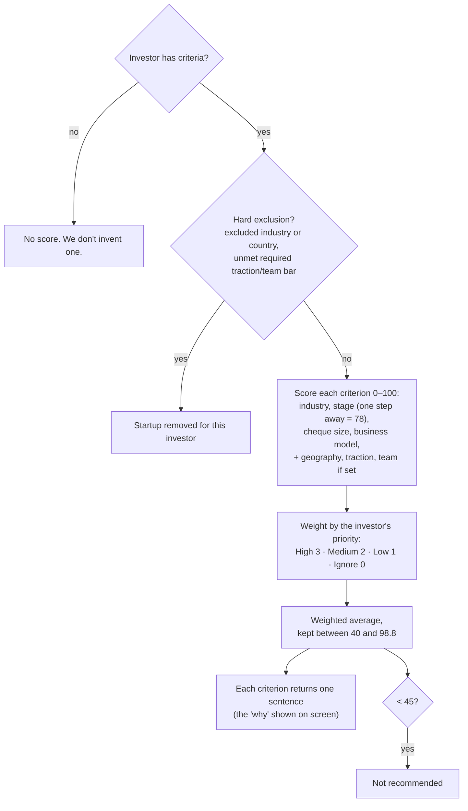
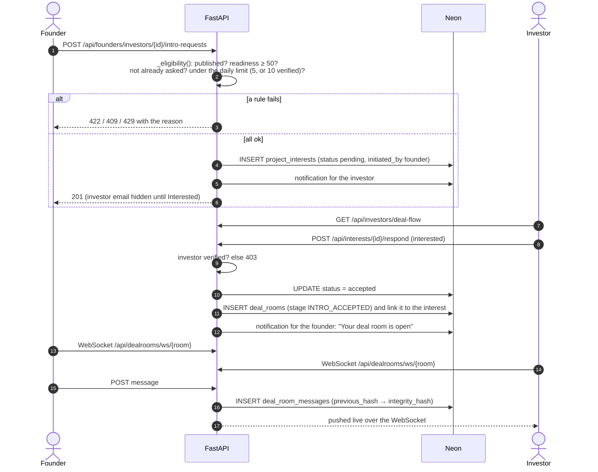

# User data flow

> What happens to the data a user types, from the screen to the database and back. Checked against `project_service.py`, `analysis_service.py`, `match_service.py`, `founder_outreach_service.py`, `routes/interests.py` and `deal_room_service.py` on 27 Nov 2026.

## 1. A founder saves a startup

All of this runs **synchronously inside the one request**. There is no background queue, so the founder waits until it finishes.

## 2. Readiness with AI (when the founder clicks Re-analyze)

The five dimensions are problem/solution fit, market sizing and competition, business model clarity, traction and validation, and product and technology.

## 3. Matching: how one score is made

Code: `backend/app/services/match_service.py` (`calculate_match`) and `backend/app/services/criteria.py`. No AI is involved, so the same inputs always give the same score.

## 4. Intro request to deal room (the main flow)

If the investor chooses **Pass**, a reason is required (otherwise 422). The founder sees the reason, which is the "you learn why" part of our pitch. A request with no reply expires after 14 days.

## 5. Where each piece of data lives and who can see it

| Data | Stored in | Who can see it |
|---|---|---|
| Password | Neon Auth only | nobody in our code |
| Profile, role | `app_users`, `founder_profiles`, `investor_profiles` | the user; parts shown to the other side |
| Startup details | `projects` | the founder; investors once published |
| Readiness gaps | `project_analyses` | **the founder only** |
| Uploaded files | `backend/private_uploads/` + `project_documents` | the founder; deal-room files only the two parties |
| Criteria | `investor_preferences` | the investor |
| Intro requests | `project_interests` | the founder and that investor |
| Deal-room chat | `deal_room_messages` | the two parties only |
| Audit log | `deal_room_audit_logs` | the two parties |
