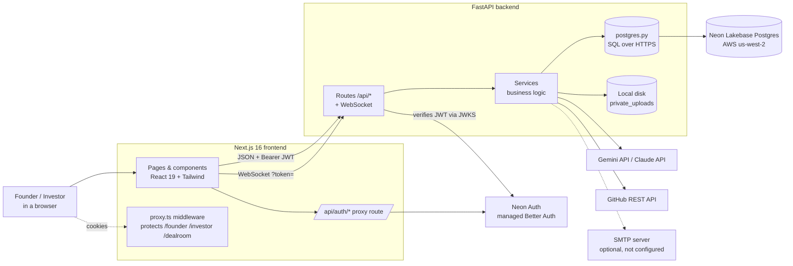
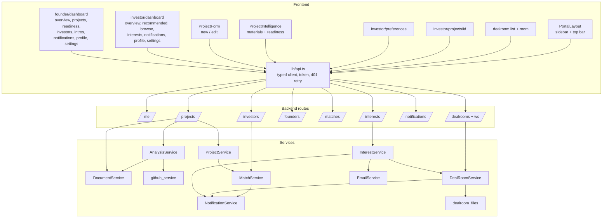
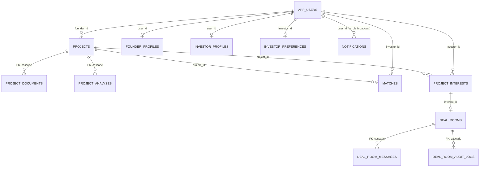
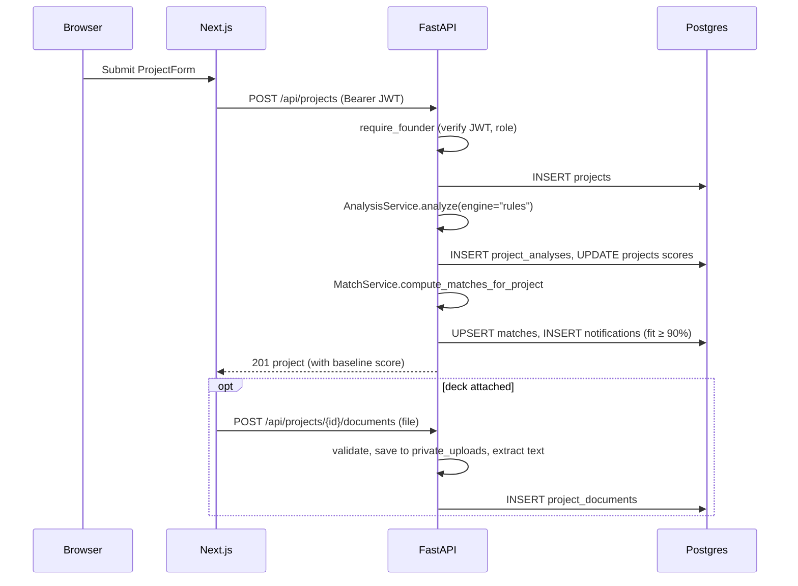
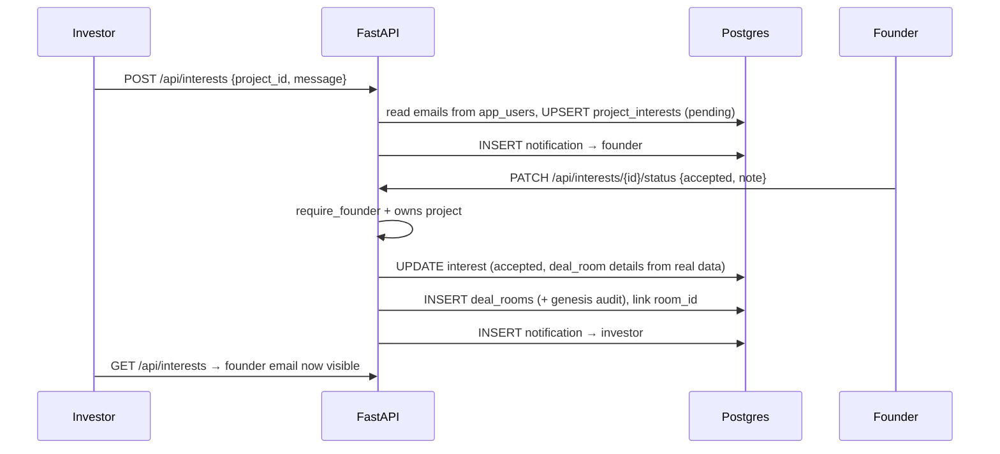
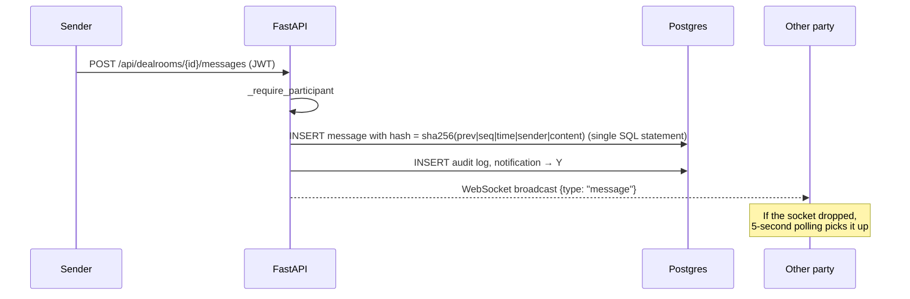
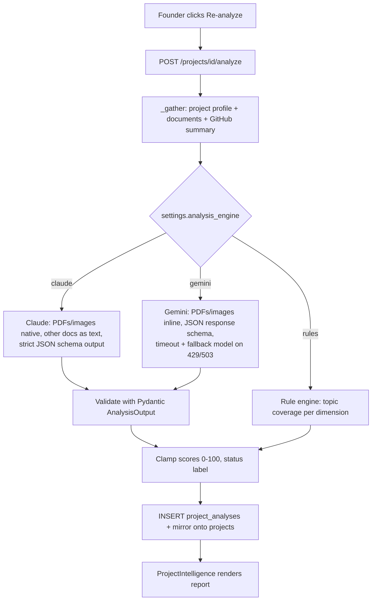
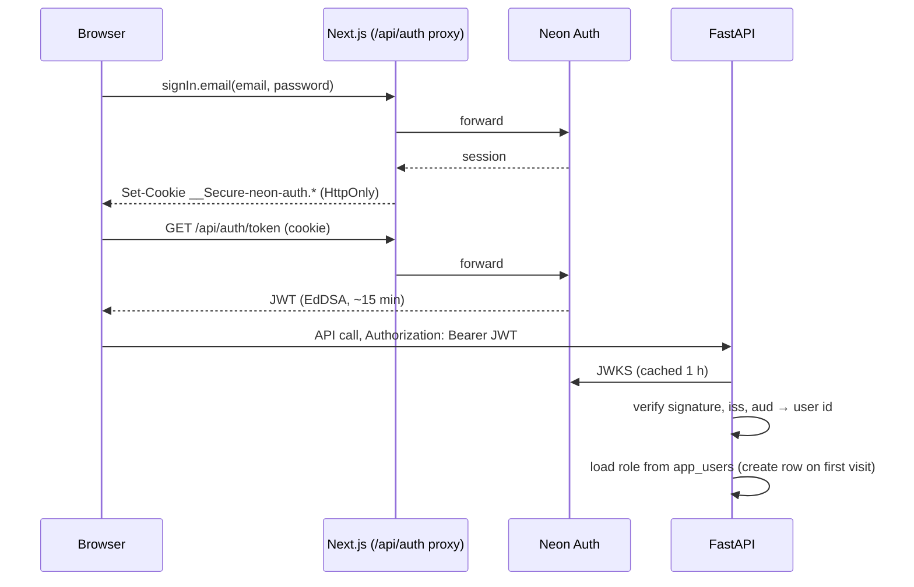
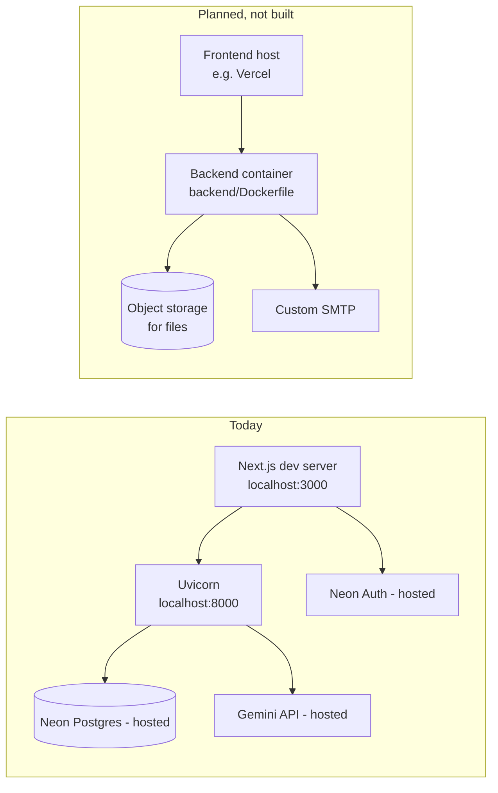

# System Architecture

All diagrams are Mermaid (they render on GitHub and in most Markdown viewers). Each is followed by a plain-language explanation.

## 1. High-level architecture

**In plain terms:** people use the website. Signing in is handled by Neon Auth through a small proxy route on the website, so the session cookie stays on our own domain. Every data request goes to the FastAPI server with a short-lived token. The server checks the token with Neon Auth's public keys, applies the business rules, and reads or writes the Neon Postgres database. For readiness reports, it also calls an AI model and GitHub. Uploaded files sit on the server's disk.

## 2. Component interaction (frontend ↔ backend)

**In plain terms:** every page goes through one API client (`lib/api.ts`). Each backend route is thin and hands off to a service. Services call each other where the business logic connects: creating a project triggers an analysis and a matching pass; accepting an intro opens a deal room and sends notifications.

## 3. Database architecture (logical)

**In plain terms:** a user is a founder or an investor. Founders own projects, and projects own their documents and analysis history. Investors have criteria. Matches and intro requests connect a project to an investor. An accepted intro opens one deal room, which holds the messages and the activity log. Only the arrows marked "FK, cascade" are enforced by the database; the rest are enforced by the application code. Table details are in `DATABASE_AND_API_DOCUMENTATION.md`.

## 4. Key request flows

### 4a. Founder creates a project

### 4b. Investor requests an intro, founder accepts, room opens

### 4c. Deal-room message in real time

## 5. AI processing workflow

**In plain terms:** the server collects everything the founder has provided and sends it to the configured AI with a fixed set of instructions, asking for a reply in a strict structure. It checks that the reply matches that structure, then saves it. Without an AI key, a transparent rule-based checker produces the same kind of report and labels it as rule-based. Details are in `AI_IMPLEMENTATION_ANALYSIS.md`.

## 6. Authentication workflow

**In plain terms:** the password goes only to Neon Auth. The browser keeps a secure session cookie and exchanges it for a short-lived token, which the frontend caches until about a minute before it expires. The backend never sees passwords. It only checks that each token was signed by Neon Auth, then looks up the user's role.

## 7. Hosting and deployment (current vs planned)

**In plain terms:** the database, sign-in and AI already run in the cloud. The website and the server still run on a developer's machine. A Dockerfile for the server exists, but nothing has been deployed yet. See `SECURITY_AND_DEPLOYMENT.md`.
